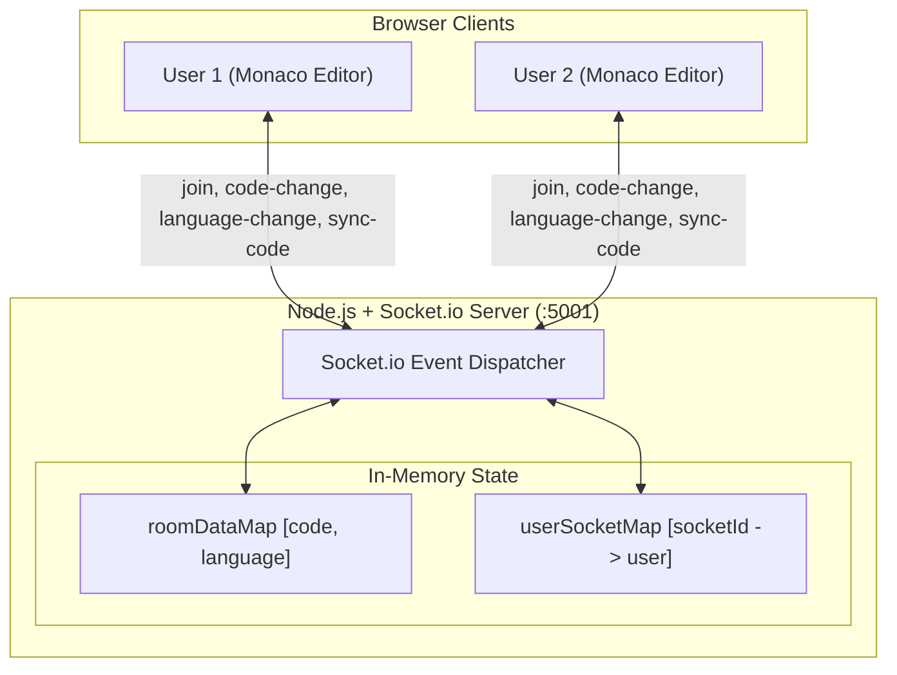

# CodeShare — Real-Time Collaborative Code Editor

A full-stack, real-time collaborative code editor built with **React**, **Node.js**, **Express**, **Socket.io**, and **Monaco Editor** (the engine powering VS Code). Users can create or join shared rooms via unique room IDs to edit code concurrently with live multi-user presence, real-time syntax highlighting, and state persistence.

---

## Features

- **Real-Time Code Collaboration**: Instant peer-to-peer code synchronization over WebSockets powered by Socket.io without echo loops.
- **VS Code Editor Experience**: Powered by Monaco Editor with syntax highlighting, line numbers, smooth scrolling, cursor blinking, and minimap.
- **Multi-Language Synchronization**: Live synchronized language switcher supporting **13 languages**:
  - JavaScript, TypeScript, Python, Java, C++, HTML, CSS, JSON, Markdown, Go, Rust, SQL, and Text.
  - When any user changes the language, all connected peers update automatically in real-time.
- **Live User Presence**: Sidebar displaying connected users with deterministic color-coded avatars and real-time online status indicators.
- **In-Memory Room State Persistence**: The server tracks room state (current code buffer and active language), so newly joined users immediately receive the up-to-date editor state even if existing users are idle.
- **Instant Room Generation & Sharing**: Cryptographically secure room UUID generation using native `crypto.randomUUID()`, with a one-click "Copy Room ID" clipboard action.
- **Presence Lifecycle Notifications**: Interactive toast alerts (via `react-hot-toast`) when collaborators join or leave the room.
- **Keyboard Shortcuts & Form Polish**: Full `Enter` key submission support on inputs, whitespace trimming validation, accessible labels, and a dark glassmorphic theme.

---

## Tech Stack

| Layer | Choice | Description |
| :--- | :--- | :--- |
| **Frontend** | React 19 | Component-driven UI with Hooks (`useRef`, `useState`, `useEffect`) |
| **Code Editor** | Monaco Editor (`@monaco-editor/react`) | VS Code's core editing engine with dynamic model tokenizer |
| **Routing** | `react-router-dom` v7 | Declarative SPA navigation and room param handling |
| **Realtime Client** | `socket.io-client` v4 | WebSocket transport with automatic reconnect and error guards |
| **Backend** | Node.js + Express 5 + `socket.io` | WebSocket server managing room subscriptions and state |
| **Notifications** | `react-hot-toast` | Throttled and deduplicated toast feedback |
| **Styling** | Modular Global CSS | Custom dark theme with glassmorphic cards and responsive layout |
| **Testing** | Jest + React Testing Library | Unit tests configured with modern ESM exports mapping |

---

## Project Structure

```
realtime-code-editor/
├── server.js                 # Express + Socket.io collaboration server
├── public/
│   ├── codesharelogo.png     # Application logo
│   ├── favicon.ico
│   ├── index.html            # Web app entrypoint and metadata
│   └── manifest.json
├── src/
│   ├── Actions.js            # Centralized socket action event constants
│   ├── App.jsx               # Router, routes, and global Toaster provider
│   ├── App.css               # Home layout, sidebar, and editor workspace styles
│   ├── App.test.js           # Frontend unit test suite
│   ├── index.js              # React DOM root entrypoint
│   ├── index.css             # Base resets and typography
│   ├── socket.js             # Client Socket.io factory
│   ├── setupTests.js         # Jest DOM & TextEncoder/Decoder polyfills
│   ├── components/
│   │   ├── Client.jsx        # User avatar badge with deterministic color hashing
│   │   └── Editor.jsx        # Monaco Editor component with live socket listeners
│   ├── Pages/
│   │   ├── Home.jsx          # Room creation & joining landing page
│   │   └── EditorPage.jsx    # Main collaborative workspace
│   └── utils/
│       └── uuid.js           # Native crypto UUID generator with fallback
└── package.json
```

---

## Getting Started

### Prerequisites

- **Node.js**: v18.0.0 or higher
- **npm**: v9.0.0 or higher

### 1. Installation

Clone the repository and install dependencies:

```bash
git clone https://github.com/your-username/realtime-code-editor.git
cd realtime-code-editor
npm install
```

### 2. Running in Development

Start both the backend server (port `5001`) and frontend development server (port `3000`) simultaneously with a single command:

```bash
npm run dev
```

Alternatively, run them in separate terminals:

```bash
# Terminal 1: Backend socket server
npm run server

# Terminal 2: React frontend
npm start
```

- **Frontend**: [http://localhost:3000](http://localhost:3000)
- **Backend Socket Server**: [http://localhost:5001](http://localhost:5001)

### 3. Running Unit Tests

```bash
npm test -- --watchAll=false
```

### 4. Production Build

```bash
npm run build
```

---

## Real-Time Collaboration Architecture



### WebSocket Event Protocol (`Actions.js`)

| Event Name | Direction | Payload | Description |
| :--- | :--- | :--- | :--- |
| `join` | Client $\rightarrow$ Server | `{ roomId, username }` | Subscribes socket to room, maps socket ID, and triggers user list broadcast. |
| `joined` | Server $\rightarrow$ Room | `{ clients, username, socketId }` | Emitted to all clients in the room when a new peer arrives. |
| `code-change` | Bi-directional | `{ roomId, code }` | Relays document buffer updates to room peers while updating server cache. |
| `language-change` | Bi-directional | `{ roomId, language }` | Synchronizes selected programming language across all peer editors. |
| `sync-code` | Client $\leftrightarrow$ Server | `{ socketId, code, language }` | Syncs existing state from active peers directly to the newcomer's socket ID. |
| `disconnected` | Server $\rightarrow$ Room | `{ socketId, username }` | Broadcasts departure and removes user from the active roster. |

---

## Environment Variables

| Variable | Default | Purpose |
| :--- | :--- | :--- |
| `PORT` | `5001` | Port used by the Node.js / Socket.io server. |
| `REACT_APP_BACKEND_URL` | `http://localhost:5001` | Socket server URL connecting the React frontend. |

---

## License

This project is licensed under the [MIT License](LICENSE).
