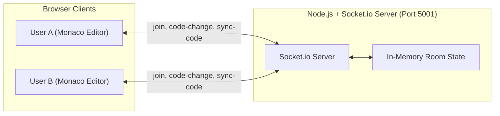

# CodeShare — Real-Time Collaborative Code Editor

A full-stack, real-time collaborative code editor built with React, Node.js, Express, Socket.io, and Monaco Editor (the engine powering VS Code). Users create or join a room via a shareable room ID, and everyone in that room edits the same document concurrently with live multi-user presence.

---

## Features

- **Real-Time Code Collaboration**: Instant peer-to-peer code synchronization over WebSockets powered by Socket.io.
- **VS Code Editor Experience**: Integrated Monaco Editor with syntax highlighting, line numbers, smooth scrolling, and minimap.
- **Multi-Language Support**: Live language switcher supporting JavaScript, TypeScript, Python, Java, C++, HTML, CSS, JSON, Markdown, Go, Rust, and SQL.
- **Live User Presence**: Connected users sidebar displaying dynamic avatar badges and real-time online status.
- **Instant Room Generation & Sharing**: Cryptographically secure UUID room generation with one-click "Copy Room ID" and toast feedback.
- **Join/Leave Lifecycle**: Real-time notifications when peers join or leave the room; graceful disconnect and cleanup.
- **Initial State Sync**: When a new participant enters an active session, the current editor buffer automatically syncs to their editor.
- **Keyboard Shortcuts & Polish**: Form submission on `Enter` key, whitespace validation, dark theme, and accessible inputs.

---

## Tech Stack

| Layer | Choice |
| :--- | :--- |
| **Frontend Framework** | React 19 |
| **Code Editor** | Monaco Editor (`@monaco-editor/react`) |
| **Routing** | `react-router-dom` v7 |
| **Realtime Client** | `socket.io-client` v4 |
| **Backend Server** | Node.js + Express 5 + `socket.io` |
| **Notifications** | `react-hot-toast` |
| **Styling** | Custom Modular CSS (Dark Theme + Glassmorphism) |
| **Testing** | Jest + React Testing Library |

---

## Project Structure

```
├── server.js                 # Node.js + Socket.io collaboration server
├── public/
│   ├── codesharelogo.png     # App logo
│   └── index.html            # Web app entry point & metadata
├── src/
│   ├── Actions.js            # Shared socket event constants
│   ├── App.jsx               # Router & toast notification provider
│   ├── App.css               # App styles & Editor page layout
│   ├── App.test.js           # Unit tests
│   ├── index.js              # React client root
│   ├── index.css             # Base resets
│   ├── socket.js             # Socket.io client initializer
│   ├── components/
│   │   ├── Client.jsx        # Connected user avatar component
│   │   └── Editor.jsx        # Monaco Editor wrapper with live socket listeners
│   ├── Pages/
│   │   ├── Home.jsx          # Room creation & joining portal
│   │   └── EditorPage.jsx    # Collaborative IDE workspace
│   └── utils/
│       └── uuid.js           # Native crypto UUID generator
└── package.json
```

---

## Getting Started

### 1. Install Dependencies

```bash
npm install
```

### 2. Start the Backend Socket Server

In your first terminal:
```bash
npm run server
```
*Server runs on `http://localhost:5001` by default.*

### 3. Start the React Frontend

In your second terminal:
```bash
npm start
```
*Frontend opens at `http://localhost:3000`.*

### 4. Run Tests

```bash
npm test
```

### 5. Production Build

```bash
npm run build
```

---

## Real-Time Socket Architecture



- **`join`**: Client joins a room with their username. Server maps `socket.id -> { username, roomId }` and broadcasts `joined` to all clients in that room.
- **`code-change`**: When a user types, delta changes are broadcasted via `socket.in(roomId).emit('code-change', { code })` to all other peers without feedback loop.
- **`sync-code`**: When a newcomer joins, an existing member syncs the latest document buffer to the newcomer's socket ID.
- **`disconnecting`**: When a client leaves or closes their tab, server notifies remaining participants with `disconnected` and updates the active user list.

---

## License

MIT
