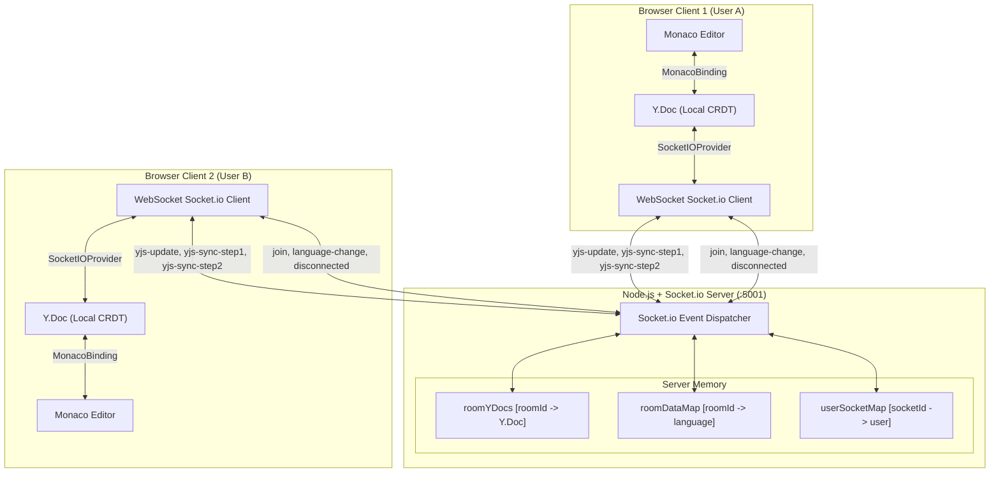

# CodeShare — Real-Time Collaborative Code Editor with Yjs CRDT

A high-performance, full-stack real-time collaborative code editor powered by **React 19**, **Monaco Editor** (the engine behind VS Code), **Socket.io**, and **Yjs CRDTs** (Conflict-free Replicated Data Types). Collaborators can create or join shared rooms to edit code concurrently with character-level mathematical conflict resolution, live cursor/selection awareness, synchronized language highlighting, and instant user presence.

---

## Features

- **Yjs CRDT Code Synchronization**: Character-level real-time document synchronization via Conflict-free Replicated Data Types (CRDTs). Edits merge deterministically with zero data loss and zero merge conflicts.
- **VS Code Editor Experience**: Powered by Monaco Editor with syntax highlighting, line numbers, smooth scrolling, bracket matching, cursor animations, and minimap.
- **Multi-Language Synchronization**: Live synchronized language switcher supporting **13 languages**:
  - JavaScript, TypeScript, Python, Java, C++, HTML, CSS, JSON, Markdown, Go, Rust, SQL, and Text.
  - When any participant changes the language, all connected peers update immediately in real-time.
- **In-Memory Server-Side Document State**: The backend maintains room-level `Y.Doc` documents. When a new collaborator arrives, the server immediately sends the full CRDT state vector, instantly populating the editor even if other peers are idle.
- **Strict-Mode Resilient Lifecycle**: Custom Monaco-Yjs binding designed specifically to handle React 18/19 StrictMode lifecycle mounts without dropped listeners or broken bindings.
- **Live User Presence**: Sidebar displaying connected users with deterministic color-coded avatars and online status indicators.
- **Instant Room Generation & Sharing**: Cryptographically secure room UUID generation using native `crypto.randomUUID()`, with a one-click "Copy Room ID" clipboard action.
- **Presence Lifecycle Notifications**: Interactive toast alerts (via `react-hot-toast`) when collaborators join or leave the room.
- **Keyboard Shortcuts & Form Polish**: Full `Enter` key submission support on inputs, whitespace trimming validation, accessible labels, and a dark glassmorphic theme.

---

## Tech Stack

| Layer | Technology | Purpose |
| :--- | :--- | :--- |
| **Frontend** | React 19 (`react`, `react-dom`) | Component-driven UI with Hooks (`useRef`, `useState`, `useEffect`) |
| **Code Editor** | Monaco Editor (`@monaco-editor/react`) | VS Code's core editing engine with dynamic model tokenizer |
| **CRDT Engine** | `yjs` | Conflict-free Replicated Data Type engine for concurrent document edits |
| **Editor Binding** | Custom `MonacoBinding` (`src/utils/y-monaco.js`) | Bidirectional sync between `Y.Text` and Monaco's text model |
| **Transport Provider** | Custom `SocketIOProvider` (`src/yjs-provider.js`) | Network sync provider relaying binary Yjs state vectors over Socket.io |
| **Routing** | `react-router-dom` v7 | Declarative SPA navigation and room parameter handling |
| **Realtime Client** | `socket.io-client` v4 | WebSocket transport with automatic reconnect and error guards |
| **Backend** | Node.js + Express 5 + `socket.io` | WebSocket server managing room subscriptions and in-memory `Y.Doc` state |
| **Notifications** | `react-hot-toast` | Throttled and deduplicated toast feedback |
| **Styling** | Modular Global CSS | Custom dark theme with glassmorphic cards and responsive layout |
| **Testing** | Jest + React Testing Library | Unit tests configured with modern ESM exports mapping |

---

## Project Structure

```
realtime-code-editor/
├── server.js                     # Express + Socket.io server with room Y.Doc state
├── public/
│   ├── codesharelogo.png         # Application logo
│   ├── favicon.ico
│   ├── index.html                # Web app entrypoint and metadata
│   └── manifest.json
├── src/
│   ├── Actions.js                # Centralized socket action event constants
│   ├── App.jsx                   # Router, routes, and global Toaster provider
│   ├── App.css                   # Home layout, sidebar, and editor workspace styles
│   ├── App.test.js               # Frontend unit test suite
│   ├── index.js                  # React DOM root entrypoint
│   ├── index.css                 # Base resets and typography
│   ├── socket.js                 # Client Socket.io factory
│   ├── setupTests.js             # Jest DOM & TextEncoder/Decoder polyfills
│   ├── yjs-provider.js           # Custom Socket.io transport provider for Yjs
│   ├── components/
│   │   ├── Client.jsx            # User avatar badge with deterministic color hashing
│   │   └── Editor.jsx            # Monaco Editor with Yjs CRDT binding
│   ├── Pages/
│   │   ├── Home.jsx              # Room creation & joining landing page
│   │   └── EditorPage.jsx        # Main collaborative workspace
│   └── utils/
│       ├── uuid.js               # Native crypto UUID generator with fallback
│       └── y-monaco.js           # Robust Monaco-Yjs model binding
└── package.json
```

---

## Getting Started

### Prerequisites

- **Node.js**: v18.0.0 or higher
- **npm**: v9.0.0 or higher

### 1. Installation

Clone the repository and install dependencies:

```bash
git clone https://github.com/your-username/realtime-code-editor.git
cd realtime-code-editor
npm install
```

### 2. Running in Development

Start both the backend server (port `5001`) and frontend development server (port `3000`) simultaneously with a single command:

```bash
npm run dev
```

Alternatively, run them in separate terminals:

```bash
# Terminal 1: Backend socket server
npm run server

# Terminal 2: React frontend
npm start
```

- **Frontend**: [http://localhost:3000](http://localhost:3000)
- **Backend Socket Server**: [http://localhost:5001](http://localhost:5001)

### 3. Running Unit Tests

```bash
npm test -- --watchAll=false
```

### 4. Production Build

```bash
npm run build
```

---

## Architecture & Synchronization Model



### Synchronization Protocol

1. **Initial Room Join (`join`)**:
   - The client emits `join` with `{ roomId, username }`.
   - The server creates or fetches the room's persistent `Y.Doc`.
   - The server immediately responds with `yjs-sync-step2` containing the full binary state vector of the room, instantly initializing the newcomer's editor with the current code.
2. **Incremental Edits (`yjs-update`)**:
   - As a user types, `MonacoBinding` transacts changes directly into `Y.Text`.
   - `SocketIOProvider` catches the document's update event and emits `yjs-update` with `{ roomId, update }`.
   - The server applies the update to its room `Y.Doc` via `Y.applyUpdate(...)` and immediately broadcasts the raw update to all other room peers (`socket.to(roomId)`).
   - Peer clients apply the update to their local `Y.Doc` with origin tracking (preventing echo loops), and `MonacoBinding` applies delta edits to their Monaco editor model.
3. **Language Switch (`language-change`)**:
   - Synchronized separately over Socket.io as room metadata so syntax highlighting updates instantaneously across all active editors.

### WebSocket Event Protocol (`Actions.js`)

| Event Name | Direction | Payload | Description |
| :--- | :--- | :--- | :--- |
| `join` | Client $\rightarrow$ Server | `{ roomId, username }` | Subscribes socket to room, registers user, and sends initial state. |
| `joined` | Server $\rightarrow$ Room | `{ clients, username, socketId }` | Emitted to all clients in the room when a new peer arrives. |
| `yjs-update` | Bi-directional | `{ roomId, update }` | Broadcasts incremental binary Yjs CRDT document updates. |
| `yjs-sync-step1` | Client $\rightarrow$ Server | `{ roomId, stateVector }` | Client sends its current state vector to request missing updates. |
| `yjs-sync-step2` | Server $\rightarrow$ Client | `{ update }` | Server sends the missing diff update to complete synchronization. |
| `language-change` | Bi-directional | `{ roomId, language }` | Synchronizes selected programming language across all peer editors. |
| `disconnected` | Server $\rightarrow$ Room | `{ socketId, username }` | Broadcasts departure and removes user from the active roster. |

---

## Environment Variables

| Variable | Default | Purpose |
| :--- | :--- | :--- |
| `PORT` | `5001` | Port used by the Node.js / Socket.io server. |
| `REACT_APP_BACKEND_URL` | `http://localhost:5001` | Socket server URL connecting the React frontend. |

---

## License

This project is licensed under the [MIT License](LICENSE).
